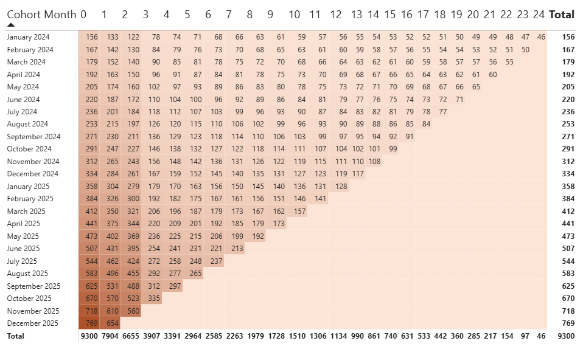
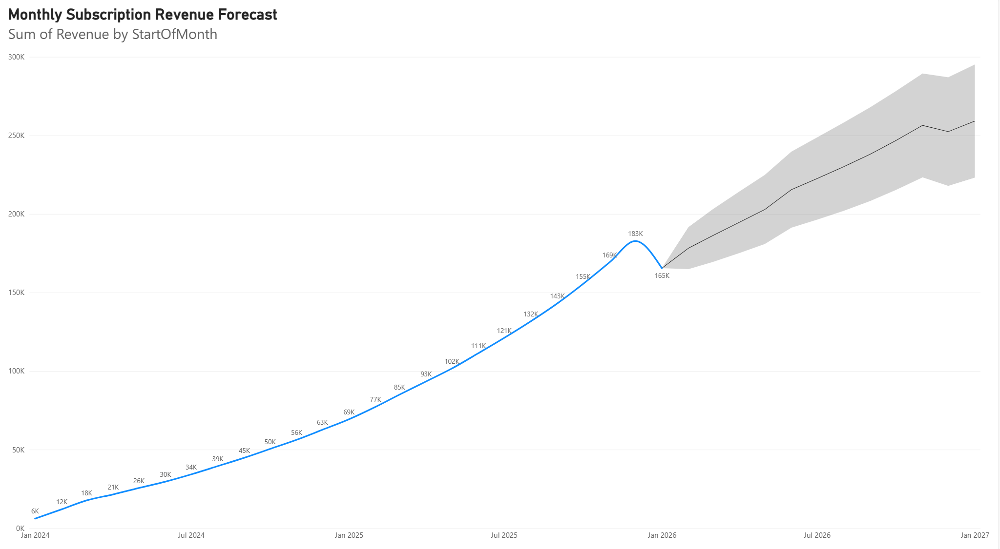
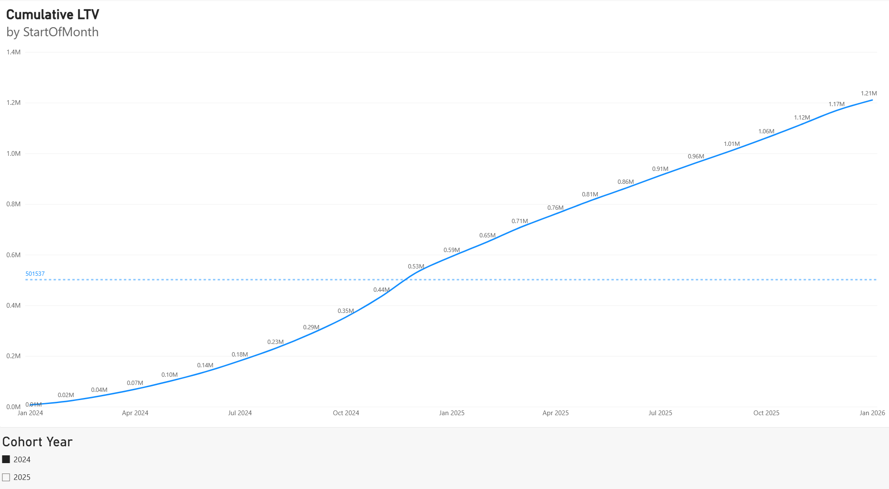
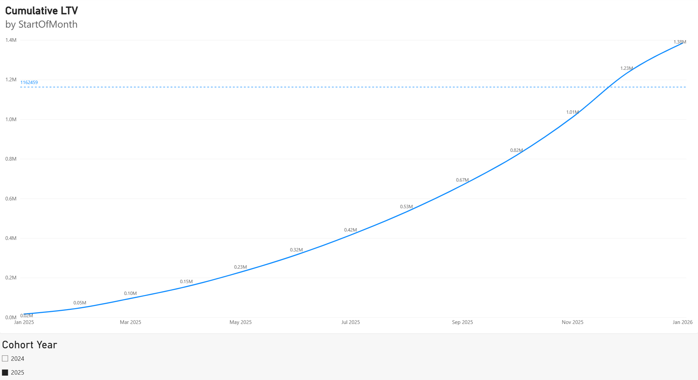
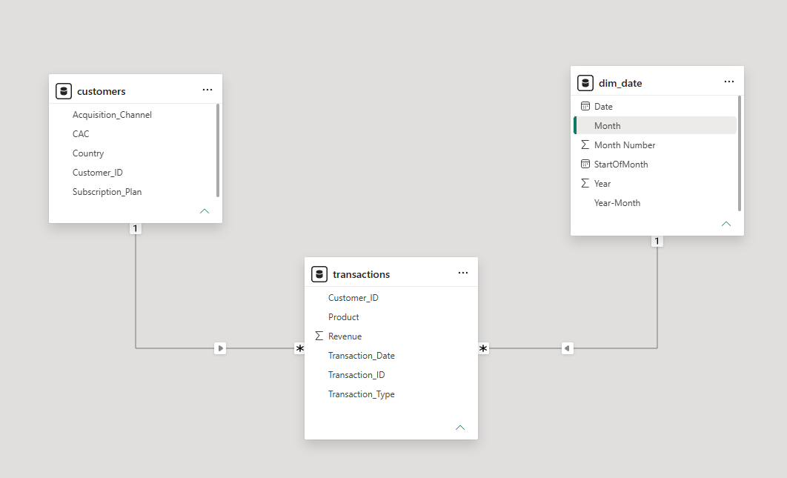

# FitnessHub Subscription Analytics

## Project Overview
This project looks at subscription data from FitnessHub, a fitness company. The data has 9,300 customers and 64,979 transactions from January 2024 to January 2026. The report was built in Power BI and has three pages: Customer Cohort, Revenue Forecast, and CAC vs. LTV.

## Key Insights

### 1. Customer Cohort Analysis
**After how many months do customers typically cancel their subscriptions?**

Most customers cancel after about 3 months. The cohort table shows the biggest drop in active customers between month 2 and month 3 (6,655 down to 3,907 customers). After that, the number keeps going down more slowly.

### 2. Revenue Forecast
**What is the expected subscription revenue over the next 12 months? Does the forecast show seasonality?**

Monthly subscription revenue is expected to grow from about $178K in February 2026 to about $259K in January 2027. The 95% confidence band at the end is about $223K to $295K. The forecast does not show a clear seasonal pattern. The line goes up steadily and does not repeat the same ups and downs each year.

### 3. CAC vs. LTV
**How long does it take for the 2024 and 2025 cohorts to recover their customer acquisition cost?**

The 2024 cohort has a total CAC of about $501.5K. Its cumulative LTV passes this amount in December 2024, which is about 12 months after the cohort year started.

The 2025 cohort has a total CAC of about $1.16M. Its cumulative LTV passes this amount in December 2025, also about 12 months after the cohort year started.

Both cohorts recover their acquisition cost within about one year.

## Data Model
The model is a star schema. `transactions` is the fact table. `customers` and `dim_date` are dimension tables, and each has a one-to-many relationship with `transactions`.

## Repository Contents
- `report.pbix`: the Power BI report
- `data/Fitness_Subscriptions_Dataset.xlsx`: the source data
- `screenshots/`: images of each report page and the data model
